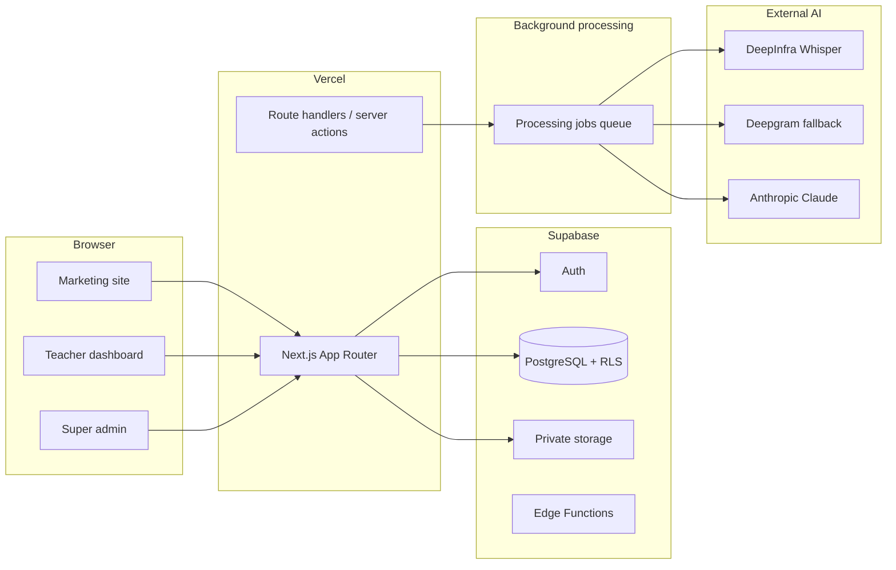

# Architecture

## High-level

## Security principles

- No provider secrets in client bundles
- RBAC enforced in Postgres RLS + server routes
- Super admin role assigned only by existing super admins
- Private recordings and payment proofs in private buckets with signed URLs
- Long-running transcription/analysis outside synchronous Vercel request lifecycle

## Module boundaries (target)

- `src/app/(marketing)` — public site
- `src/app/dashboard` — tutor workspace
- `src/app/admin` — platform administration
- `src/lib/supabase` — auth/data clients
- `supabase/migrations` — schema source of truth
